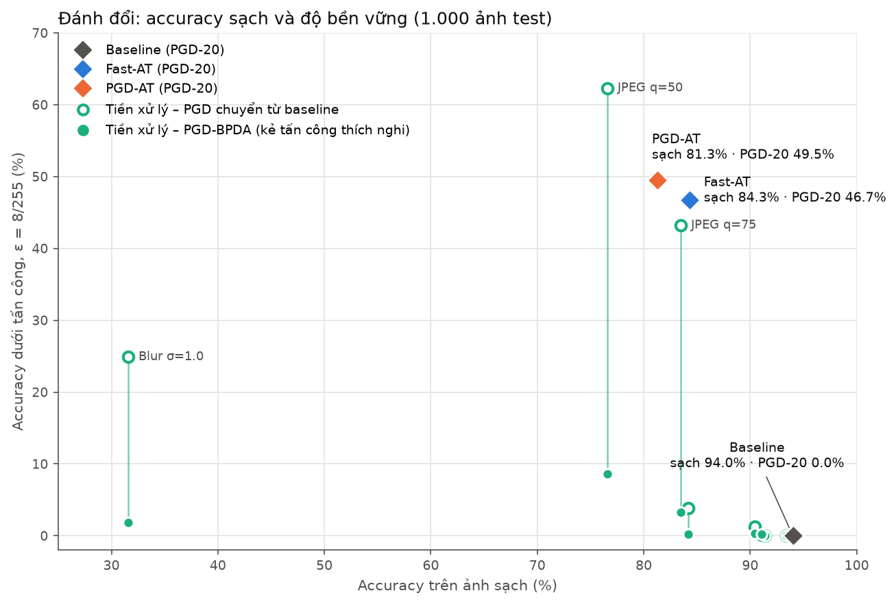

# Nghiên cứu và phòng thủ trước tấn công đối kháng lên mô hình phân loại ảnh

Đồ án môn **An toàn thông tin**, đề tài 2.21. Dự án sử dụng ResNet-18 phiên bản CIFAR trên CIFAR-10 để đo mức suy giảm độ chính xác trước tấn công FGSM/PGD và đánh giá các biện pháp phòng thủ.

**Phần tấn công đã hoàn thành cài đặt và đánh giá baseline trên 1.000 ảnh test cố định, seed 42.** Accuracy sạch đạt **94,0%**; tại epsilon **8/255**, accuracy còn **21,8% với FGSM** và **0,0% với PGD-10**. Các con số này được đo thực tế trên CPU với checkpoint baseline nhóm cung cấp.

## Thành viên và phạm vi công việc

| Thành viên | Phụ trách |
|---|---|
| Nguyễn Quang Huy | FGSM, PGD; notebook đánh giá tấn công; số liệu, biểu đồ và ảnh minh họa |
| Nguyễn Phương Đông | Adversarial Training và Input Preprocessing; notebook huấn luyện, đánh giá phòng thủ |

Lượt đánh giá được trình bày trong README này thuộc phần tấn công. Mô hình baseline được nạp từ checkpoint có sẵn. Các notebook phòng thủ và kết quả Fast-AT/preprocessing do thành viên phòng thủ phụ trách; kết quả được đối chiếu trong bộ báo cáo chia sẻ qua Google Drive.

## Phần tấn công đã thực hiện

| Thành phần | Nội dung |
|---|---|
| [src/attacks.py](src/attacks.py) | Hoàn thiện FGSM và PGD, hỗ trợ targeted/untargeted, random start và projection L∞ |
| [notebooks/02_attacks.ipynb](notebooks/02_attacks.ipynb) | Nạp baseline, lấy tập đánh giá, đo accuracy/ASR/thời gian và xuất kết quả |
| [requirements-attacks.txt](requirements-attacks.txt) | Các phiên bản thư viện của môi trường đánh giá CPU |
| [scripts/verify_attack_results.py](scripts/verify_attack_results.py) | Đối chiếu kết quả đã lưu; hỗ trợ đọc dữ liệu tải từ Drive bằng `--results-dir` |

Hai chữ ký công khai được giữ nguyên theo [docs/INTERFACE.md](docs/INTERFACE.md):

```python
fgsm(model, x, y, eps, targeted=False)
pgd(model, x, y, eps, alpha, steps, random_start=True, targeted=False)
```

Các quy ước kỹ thuật:

- Ảnh đầu vào có shape `[N,3,32,32]`, pixel trong `[0,1]`, cùng thiết bị với mô hình. Normalize nằm bên trong `build_model()`.
- `y` là nhãn thật; với `targeted=True`, `y` là nhãn đích và thuật toán cập nhật theo chiều giảm loss.
- Kết quả giữ shape/device/dtype, đã detach, nằm trong `[0,1]` và có nhiễu bị giới hạn bởi epsilon theo chuẩn L∞. PGD chiếu về miền hợp lệ sau mỗi bước.
- Hàm tấn công dùng `torch.autograd.grad` theo ảnh, giữ nguyên gradient trọng số và chế độ train/eval. Người gọi đặt `model.eval()`.
- PGD lấy nhiễu khởi tạo đều trong `[-eps, eps]` khi `random_start=True`. Đã xử lý các trường hợp `eps=0`, `steps=0` và tham số không hợp lệ.

Notebook tái sử dụng `build_model()`, `get_eval_subset()` và `accuracy_under_attack()` dùng chung với phần phòng thủ.

## Thiết kế thực nghiệm

| Thành phần | Thiết lập đã chạy |
|---|---|
| Mô hình | Normalize + ResNet-18 bản CIFAR |
| Checkpoint | `baseline_resnet18.pth`, state_dict của `build_model()` |
| Tập đánh giá | 1.000 ảnh CIFAR-10 test qua `get_eval_subset(as_tensors=True)` |
| Seed và batch size | Seed 42; batch 128; đặt lại seed trước mỗi cấu hình |
| Kịch bản | White-box, untargeted, digital |
| Epsilon L∞ | 1/255, 2/255, 4/255, 8/255 |
| PGD | 10 bước, alpha 2/255, random start, một lần khởi tạo |
| Môi trường | Python 3.14.2, PyTorch 2.11.0+cpu, torchvision 0.26.0+cpu, NumPy 2.4.4 |
| Thiết bị thực đo | CPU, 4 luồng |

Các thông số thí nghiệm được lấy từ [src/config.py](src/config.py). Accuracy sạch và accuracy sau tấn công trong bảng dưới dùng cùng tập 1.000 ảnh; chúng không phải accuracy trên toàn bộ 10.000 ảnh test.

## Kết quả đánh giá baseline

Baseline dự đoán đúng **940/1.000 ảnh sạch**, tương ứng **94,0% accuracy**.

| Epsilon | FGSM accuracy | PGD-10 accuracy | FGSM ASR | PGD-10 ASR |
|---|---:|---:|---:|---:|
| 1/255 | 55,7% | 52,3% | 40,74% | 44,36% |
| 2/255 | 38,5% | 8,8% | 59,04% | 90,64% |
| 4/255 | 27,5% | 0,7% | 70,74% | 99,26% |
| 8/255 | 21,8% | 0,0% | 76,81% | 100,00% |

**Accuracy** là tỷ lệ dự đoán đúng trên toàn bộ 1.000 ảnh. **ASR** chỉ tính các ảnh baseline ban đầu đoán đúng:

```text
ASR = số ảnh sạch đúng nhưng sau tấn công sai / 940 × 100%
```

Tại epsilon 8/255, FGSM làm sai **722/940** ảnh vốn được đoán đúng; PGD-10 làm sai **940/940** ảnh đó. Trong các cấu hình đã đo, PGD làm giảm accuracy mạnh hơn FGSM ở cùng ngân sách nhiễu. Kết quả cho thấy accuracy sạch cao chưa đủ để đánh giá khả năng chống chịu tấn công đối kháng.

Chi phí tạo nhiễu tại epsilon 8/255, cho cùng 1.000 ảnh:

| Thuật toán | Thời gian tạo nhiễu trên CPU |
|---|---:|
| FGSM | 19,48 giây |
| PGD-10 | 212,74 giây |

Toàn bộ lượt chạy notebook mất khoảng **15,6 phút**. Thời gian này phụ thuộc phần cứng và batch size. Kết quả hiện tại mô tả PGD-10 với một khởi tạo; chúng không chứng minh độ bền vững trước mọi tấn công. API hỗ trợ targeted đã được kiểm tra về chiều gradient; bảng trên là benchmark untargeted.

### Tấn công có mục tiêu

[notebooks/02b_targeted_attack.ipynb](notebooks/02b_targeted_attack.ipynb) dùng PGD-10 targeted trên baseline, cùng tập 1.000 ảnh:

| ε | Mèo → chó (91 ảnh cat) | Mèo bị đoán sai bất kỳ | Nhãn đích ngẫu nhiên (940 ảnh) | Untargeted ASR |
|---|---:|---:|---:|---:|
| 1/255 | 34,1% | 72,5% | 8,1% | 44,4% |
| 2/255 | 90,1% | 96,7% | 54,3% | 90,6% |
| 4/255 | 100,0% | 100,0% | 94,5% | 99,3% |
| 8/255 | 100,0% | 100,0% | 99,8% | 100,0% |

Ở ε nhỏ, targeted khó hơn rõ rệt so với untargeted vì phải vượt qua đúng một ranh giới quyết định. Cặp mèo → chó dễ hơn nhãn đích ngẫu nhiên vì *dog* là lớp gần *cat* nhất. Đến ε = 8/255, kẻ tấn công gần như luôn ép được baseline trả về đúng nhãn mình chọn. Kết quả lưu trong `results/targeted_metrics.json`, `targeted_success.png` và `targeted_examples_cat_to_dog.png`.

## Kết quả phòng thủ

Hai nhóm biện pháp phòng thủ được đánh giá trên cùng 1.000 ảnh test (seed 42), ε = 8/255, white-box:

- **Adversarial Training** ([03a](notebooks/03a_adversarial_training.ipynb)): ResNet-18 huấn luyện từ đầu 30 epoch trên ảnh đối kháng, theo Fast-AT (FGSM có random start, α = 10/255) và PGD-AT (PGD-7, α = 2/255). Checkpoint được chọn theo PGD-10 accuracy trên tập đánh giá.
- **Tiền xử lý đầu vào** ([03b](notebooks/03b_preprocessing.ipynb)): JPEG, giảm bit màu, Gaussian blur đặt trước baseline, đo với kẻ tấn công không biết phòng thủ và kẻ tấn công thích nghi (BPDA).

| Phương pháp | Sạch (10k test) | Sạch (1k) | FGSM | PGD-10 | PGD-20 | Tấn công thích nghi | Huấn luyện (giây/epoch) |
|---|---:|---:|---:|---:|---:|---:|---:|
| Baseline | 93,8 | 94,0 | 21,7 | 0,0 | 0,0 | 0,0 | – |
| Fast-AT | 84,2 | 84,3 | 55,3 | 48,2 | 46,7 | 46,7 | 63 |
| PGD-AT | 81,0 | 81,3 | 55,2 | **51,0** | **49,5** | **49,5** | 219 |
| Baseline + JPEG q=75 | – | 83,5 | 39,8 | 43,2 | – | 3,3 | 0 |
| Baseline + JPEG q=50 | – | 76,6 | 51,6 | 62,3 | – | 8,6 | 0 |
| Baseline + 3-bit | – | 84,2 | 26,9 | 3,8 | – | 0,2 | 0 |
| Baseline + Blur σ=1,0 | – | 31,6 | 26,3 | 24,9 | – | 1,8 | 0 |

Bảng đầy đủ (mọi cấu hình tiền xử lý, chi phí suy luận) nằm trong [results/summary_comparison.md](results/summary_comparison.md). Với tiền xử lý, FGSM/PGD-10 được sinh trên baseline rồi mới đi qua bước tiền xử lý; cột "thích nghi" là PGD-10 + BPDA tấn công trực tiếp `f(g(x))`. Với baseline/AT, tấn công vốn đã nhắm trực tiếp vào mô hình nên PGD-20 chính là tấn công thích nghi. Số liệu baseline trong bảng này lấy từ cùng lượt đánh giá với AT; lượt đo riêng của phần tấn công lệch ≤ 0,1 điểm.



Nhận xét chính:

- **Adversarial Training là biện pháp duy nhất bền vững thật**: PGD-AT nâng accuracy dưới PGD-20 từ 0% lên 49,5%, đổi lại accuracy sạch giảm khoảng 13 điểm. Fast-AT đạt gần như tương đương (46,7%) với chi phí huấn luyện chỉ bằng khoảng 1/3,5. Không xuất hiện catastrophic overfitting.
- **Tiền xử lý chỉ tạo cảm giác an toàn giả**: JPEG q=50 trông như chống được PGD (62,3%), nhưng khi kẻ tấn công biết có bước JPEG và dùng BPDA, accuracy rơi còn 8,6%. Đây là hiện tượng gradient masking/obfuscation (Athalye et al., 2018).
- Phép biến đổi càng mạnh thì accuracy sạch càng giảm (Blur σ=1,0 còn 31,6%), trong khi không mang lại độ bền vững trước tấn công thích nghi.

Bảng và biểu đồ được tạo lại từ các file JSON bằng `python scripts/make_summary_figures.py`; chi phí suy luận đo bằng `python scripts/measure_inference_cost.py`.

## Kết quả và báo cáo trên Google Drive

Mã nguồn và README được chia sẻ qua GitHub. Tài liệu bàn giao, DOCX và các file kết quả được tổ chức riêng trong thư mục `AdvML_Project` để chia sẻ qua Google Drive.

| File sinh bởi notebook | Nội dung |
|---|---|
| `results/attack_metrics.json` | Accuracy, ASR, thời gian, giới hạn nhiễu, cấu hình và thông tin tái lập |
| `results/attack_metrics.csv` | Bảng số liệu theo thuật toán và epsilon |
| `results/attack_predictions.csv` | Chỉ số test, nhãn thật và dự đoán của từng ảnh trước/sau tấn công |
| `results/attack_accuracy.png` | Biểu đồ accuracy theo epsilon của FGSM và PGD |
| `results/attack_examples_fgsm.png` | Ảnh gốc, nhiễu phóng đại và ảnh đối kháng FGSM |
| `results/attack_examples_pgd.png` | Ảnh gốc, nhiễu phóng đại và ảnh đối kháng PGD |

Ảnh minh họa chọn các ca baseline đoán đúng nhưng sau tấn công bị sai, kèm nhãn dự đoán, xác suất softmax và L∞ thực tế. Chỉ cột nhiễu được phóng đại; ảnh gốc và đối kháng giữ pixel thật.

Bộ chia sẻ được bố trí như sau:

```text
AdvML_Project/
├── checkpoints/       # Trọng số dùng chung
├── cifar-10-python/   # CIFAR-10 đã giải nén, nếu có
├── results/           # Kết quả phòng thủ
│   └── attack/        # Sáu file kết quả tấn công đã bàn giao
└── report/            # ATTACK_HANDOFF.md, INTERFACE.md và các DOCX
```

Bộ kết quả tấn công đã bàn giao nằm trong `AdvML_Project/results/attack/`. Khi chạy lại, notebook ghi vào `results/` của repo và sao lưu vào `AdvML_Project/results/` trên Colab; chọn `--results-dir` trỏ đến thư mục chứa trực tiếp `attack_metrics.json` khi kiểm tra.

JSON giữ các khóa chung `model`, `clean_acc`, `fgsm`, `pgd`; các khóa epsilon có dạng `k/255`. Các trường bổ sung ghi ASR, thời gian, seed, thiết bị, phiên bản thư viện và SHA-256 của checkpoint/mã nguồn. Khi ghép với phần phòng thủ, dùng đúng tập đánh giá: ví dụ, Fast-AT có `clean_acc_eval_subset` cho 1.000 ảnh và `clean_acc` cho 10.000 ảnh test.

## Chạy lại phần tấn công trên local

### Chuẩn bị mã nguồn và môi trường

```bash
git clone https://github.com/Eastern2k4/adversarial-attack-defense.git
cd adversarial-attack-defense
python -m venv .venv
```

Kích hoạt môi trường:

```powershell
# Windows PowerShell
.\.venv\Scripts\Activate.ps1
```

```bash
# Linux hoặc macOS
source .venv/bin/activate
```

Dùng Python 3.14.2 để đối chiếu với môi trường tham chiếu CPU:

```bash
python -m pip install torch==2.11.0 torchvision==0.26.0 --index-url https://download.pytorch.org/whl/cpu
python -m pip install -r requirements-attacks.txt
```

### Chuẩn bị dữ liệu và chạy notebook

Nhận checkpoint `baseline_resnet18.pth` từ thư mục Drive của nhóm. Notebook tìm checkpoint/dữ liệu trong repo trước, sau đó trong `AdvML_Project` nằm cạnh repo:

```text
Project5/
├── adversarial-attack-defense/
│   ├── checkpoints/baseline_resnet18.pth  # Cách đặt trong repo
│   └── data/cifar-10-batches-py/
└── AdvML_Project/
    ├── checkpoints/baseline_resnet18.pth  # Hoặc dùng thư mục của nhóm
    └── cifar-10-python/cifar-10-batches-py/
```

Mở [notebooks/02_attacks.ipynb](notebooks/02_attacks.ipynb), chọn kernel `.venv` và **Run All**. Chỉ cần một trong hai cách đặt dữ liệu/checkpoint trên. Nếu dữ liệu chưa có, notebook tải CIFAR-10 qua torchvision.

Kết quả mới được ghi vào `results/` của repo. Notebook lưu JSON sau từng cấu hình với `evaluation.completed=False`, chuyển thành `True` sau khi đo đủ tám cấu hình, rồi xuất CSV và PNG ở các cell tiếp theo. Nếu phiên chạy bị ngắt, chạy lại từ đầu để tạo bộ kết quả đầy đủ.

## Chạy phần tấn công trên Colab

1. Mở [notebook trên Colab](https://colab.research.google.com/github/Eastern2k4/adversarial-attack-defense/blob/main/notebooks/02_attacks.ipynb).
2. Bật GPU và chạy setup để mount Google Drive. Repo mới được clone từ biến `REPO_BRANCH="main"`.
3. Đặt checkpoint trong `MyDrive/AdvML_Project/checkpoints`. Có thể đặt dữ liệu giải nén hoặc `cifar-10-python.tar.gz` trong `AdvML_Project` để notebook dùng lại.
4. Chạy các cell còn lại. Cell cuối sao lưu các file kết quả tấn công sang `MyDrive/AdvML_Project/results`.

Nếu thư mục repo đã tồn tại từ phiên trước (vd. vẫn ở nhánh `feat/attack-code` cũ), cập nhật và chọn đúng nhánh **trước cell imports**:

```python
subprocess.run(["git", "-C", str(REPO_DIR), "fetch", "origin"], check=True)
subprocess.run(["git", "-C", str(REPO_DIR), "switch", "main"], check=True)
subprocess.run(["git", "-C", str(REPO_DIR), "pull"], check=True)
```

Cấu hình CPU trong `requirements-attacks.txt` phục vụ đối chiếu lượt đo local; Colab cần bản torch/torchvision hỗ trợ GPU của runtime. Lượt đánh giá công bố ở trên chạy trên CPU; đường chạy Colab/GPU chưa được thực đo trong lượt bàn giao này.

## Kiểm tra kết quả đã tải từ Drive

Sau khi cài môi trường, có thể đối chiếu số liệu mà không chạy lại benchmark:

```bash
python scripts/verify_attack_results.py --results-dir ../AdvML_Project/results/attack
```

Đối chiếu thêm trọng số nếu đã nhận checkpoint:

```bash
python scripts/verify_attack_results.py --results-dir ../AdvML_Project/results/attack --checkpoint ../AdvML_Project/checkpoints/baseline_resnet18.pth
```

Script kiểm tra chữ ký hàm, tập chỉ số test seed 42, JSON/CSV, accuracy/ASR theo dự đoán từng ảnh, giới hạn nhiễu đã ghi, mã băm nguồn/checkpoint, định dạng notebook và các PNG. Các kiểm tra trực tiếp trước đó đã xác nhận chiều targeted, giới hạn nhiễu ở các bước PGD, gradient trọng số có sẵn, chế độ train/eval và gọi tấn công trong `torch.no_grad()`.

## Đối chiếu yêu cầu và trạng thái dự án

| Yêu cầu | Trạng thái và căn cứ |
|---|---|
| FGSM và PGD giữ đúng giao diện chung | Đạt; chữ ký hàm và quy ước nhãn được giữ nguyên |
| Đầu ra detach, pixel hợp lệ, nhiễu L∞ có giới hạn | Đạt; kiểm tra từng batch với dung sai số thực 1e-6 |
| Giữ gradient trọng số và chế độ mô hình | Đạt; dùng autograd.grad theo ảnh, đã kiểm tra hành vi |
| 1.000 ảnh test seed 42, bốn epsilon thống nhất | Đạt; cấu hình, chỉ số từng ảnh và hash được ghi trong kết quả |
| Số liệu và biểu đồ cho tối thiểu hai tấn công | Đạt; đã đo đủ tám cấu hình FGSM/PGD |
| Minh họa ảnh gốc, nhiễu và ảnh đối kháng | Đạt; hai bộ PNG kèm nhãn và confidence |
| Hướng dẫn tái lập và kiểm tra kết quả | Có notebook, môi trường tham chiếu và script kiểm tra |
| Adversarial Training (bắt buộc) | Đạt; Fast-AT và PGD-AT, đánh giá trên ảnh sạch, FGSM, PGD-10 và PGD-20 |
| Biện pháp phòng thủ thứ hai | Đạt; JPEG, giảm bit màu, Gaussian blur, có đánh giá kẻ tấn công thích nghi (BPDA) |
| Bảng so sánh đánh đổi robustness và accuracy | Đạt; `results/summary_comparison.md`, `summary_tradeoff.png`, `summary_robustness_eps.png` |
| Targeted attack (nâng cao) | Có notebook `02b_targeted_attack.ipynb` (mèo → chó, nhãn đích ngẫu nhiên) |
| Notebook demo | `04_demo.ipynb`, chỉ nạp checkpoint, chạy vài giây trên CPU |
| Báo cáo tổng hợp toàn dự án | Đang hoàn thiện |
| C&W, chuyển giao giữa kiến trúc, tấn công vật lý | Phần mở rộng tùy chọn; chưa benchmark trong bộ kết quả này |

## Cấu trúc và thứ tự chạy dự án

```text
├── notebooks/
│   ├── 01_baseline.ipynb
│   ├── 02_attacks.ipynb
│   ├── 02b_targeted_attack.ipynb
│   ├── 03a_adversarial_training.ipynb
│   ├── 03b_preprocessing.ipynb
│   └── 04_demo.ipynb
├── src/
│   ├── config.py
│   ├── models.py
│   ├── data.py
│   ├── attacks.py
│   ├── defenses.py
│   └── utils.py
├── docs/INTERFACE.md
├── scripts/
│   ├── verify_attack_results.py
│   ├── make_summary_figures.py
│   └── measure_inference_cost.py
├── requirements.txt
├── requirements-attacks.txt
├── results/
└── report/
```

**Quy ước quan trọng:** ảnh đưa vào mô hình luôn nằm trong khoảng **[0, 1]**. Chuẩn hoá mean/std được đặt **bên trong mô hình** (lớp `Normalize` đầu mạng), không nằm trong transform, để epsilon của tấn công có ý nghĩa đúng trên thang pixel (vd. ε = 8/255).

| # | Notebook | Cần có trước | Tạo ra | Thời gian |
|---|---|---|---|---|
| 1 | `01_baseline.ipynb` | Dữ liệu CIFAR-10 | `baseline_resnet18.pth`, `results/baseline_*` | ~40 phút (T4) |
| 2 | `02_attacks.ipynb` | `baseline_resnet18.pth` | `results/attack_*` | ~16 phút (CPU 4 luồng) |
| 3a | `03a_adversarial_training.ipynb` (`MODE="fast"`) | – (so sánh với baseline nếu có) | `adv_fast_resnet18.pth`, `results/adv_training_fast_*`, `results/adv_fast_*` | ~1 giờ (T4) |
| 3a | `03a_adversarial_training.ipynb` (`MODE="pgd"`) | – | `adv_pgd_resnet18.pth`, `results/adv_training_pgd_*`, `results/adv_pgd_*` | ~4–5 giờ (T4, tự resume) |
| 2b | `02b_targeted_attack.ipynb` | `baseline_resnet18.pth` | `results/targeted_*` | ~15 phút (CPU 4 luồng) |
| 3b | `03b_preprocessing.ipynb` | `baseline_resnet18.pth` | `results/preprocessing_*` | ~10 phút (T4) |
| – | `scripts/make_summary_figures.py` | Các file JSON trong `results/` | `results/summary_*`, hai biểu đồ so sánh | vài giây |
| – | `scripts/measure_inference_cost.py` | Dữ liệu CIFAR-10 | `results/inference_cost.json` | ~1 phút (CPU) |
| 4 | `04_demo.ipynb` | Checkpoint baseline, PGD-AT (Fast-AT tùy chọn); tập đánh giá đọc từ `assets/eval_subset_seed42.npz`, không cần tải CIFAR-10 | Chỉ hiển thị, không ghi file | vài giây mỗi cell |

Notebook 3a không phụ thuộc baseline nên có thể chạy song song với Notebook 1 (trên tài khoản/phiên Colab khác). Notebook 1 và 3a tự resume từ checkpoint `*_last.pth`; nếu đã huấn luyện đủ epoch, chạy lại chỉ thực hiện phần đánh giá.

### Chạy toàn bộ dự án trên Google Colab

1. Trong Google Drive, tạo thư mục `MyDrive/AdvML_Project` (notebook cũng tự tạo nếu chưa có). Checkpoint được lưu ở `MyDrive/AdvML_Project/checkpoints`.
2. Mở notebook từ GitHub: Colab → *File → Open notebook → GitHub* → dán `https://github.com/Eastern2k4/adversarial-attack-defense` → chọn notebook.
3. Bật GPU: *Runtime → Change runtime type → T4 GPU*.
4. Chạy lần lượt các cell. Cell setup sẽ mount Drive, clone repo vào `/content` và thêm vào `sys.path`.
5. Nếu runtime bị ngắt khi đang huấn luyện: kết nối lại và chạy lại từ đầu – quá trình huấn luyện tự resume từ checkpoint trên Drive.

> Thư mục `results/` trên Colab nằm trong `/content` nên sẽ mất khi runtime kết thúc – nhớ tải file kết quả về rồi commit vào `results/` của repo.

`requirements.txt` là danh sách thư viện chung của toàn dự án; `requirements-attacks.txt` dành cho môi trường tham chiếu phần tấn công.

## Quy ước phối hợp

- A phụ trách `src/attacks.py` và `02_attacks.ipynb`; B phụ trách các notebook phòng thủ. Giữ đúng [INTERFACE.md](docs/INTERFACE.md) khi thay đổi mã dùng chung.
- Lấy thông số thí nghiệm từ `src/config.py`. Khi ghép bảng, ghi đúng tập đánh giá, checkpoint, số bước, random start và kịch bản tấn công.
- Xóa output notebook trước khi commit. Mã nguồn, notebook rỗng output, README và file kết quả trong `results/` được chia sẻ qua GitHub; DOCX báo cáo và bản sao kết quả được bàn giao qua Drive.
- **Không commit** dữ liệu (`data/`) và trọng số (`*.pth`, `*.pt`, `checkpoints/`). Chia sẻ checkpoint và dữ liệu qua `AdvML_Project` trên Drive.
- Kết quả cuối (JSON/CSV/PNG) được commit vào `results/` để báo cáo dùng chung một nguồn số liệu.
- `git pull` trước khi bắt đầu làm việc; giữ lịch sử `main` tuyến tính (rebase thay vì merge commit).
